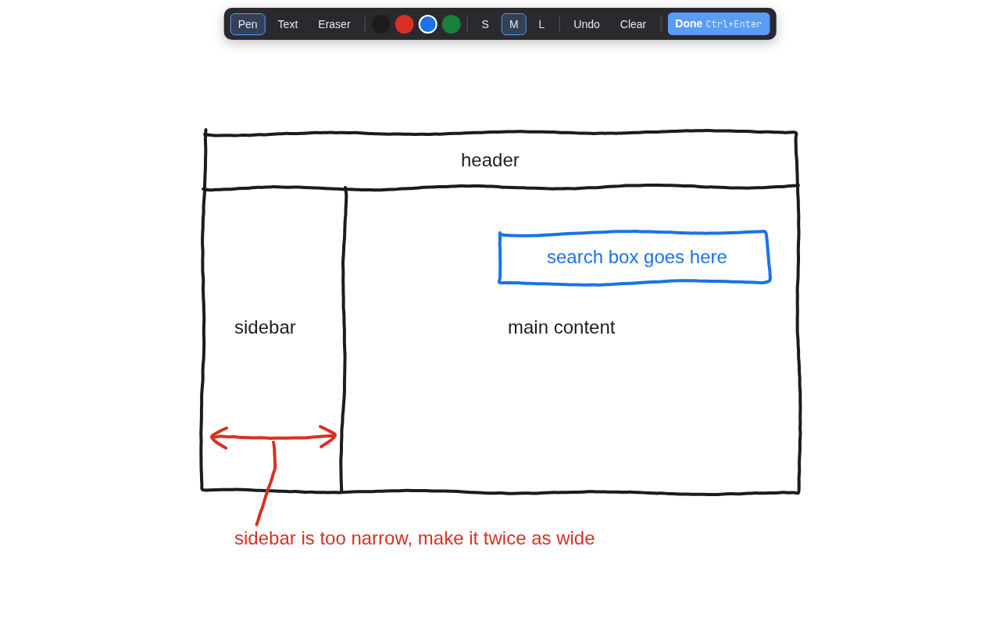
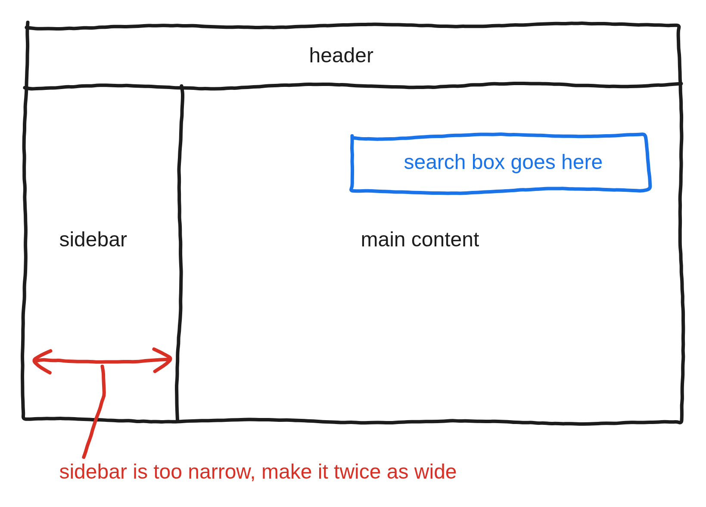

# lmexp

**"Let me explain."** Some things are faster to draw than to describe. `lmexp` is a Claude Code mod that adds the `/lmexp` slash command: it opens a blank canvas, you sketch or write what you mean, and the picture goes into your prompt for Claude to look at.



## How it goes

1. Type `/lmexp` in Claude Code. A blank canvas opens in its own window.
2. Draw, write and annotate, as above.
3. Press **Ctrl+Enter**. The window closes and the drawing is cropped and saved. This is the picture Claude gets:

   

4. Your prompt box now holds a line pointing Claude at the picture. Add your own words after it and press Enter when you are ready:

   ```
   Let me explain with a drawing. I drew it on a canvas and it is saved at
   ~/.claude/plugins/data/lmexp/lmexp-20261120-184958.png. Look at it with
   the Read tool, then respond to what it shows.

   do this for the settings page too
   ```

## Install

At the prompt of a Claude Code terminal session:

```
/plugin install lmexp --marketplace furkannurovic/lmexp
```

Answer `y` to add the marketplace, then pick a scope (the user scope makes it available in every session).

From a shell:

```
claude plugin install lmexp --marketplace furkannurovic/lmexp
```

In the desktop app, where `/plugin` does not run: click + next to the prompt box, then Plugins, Add marketplace with `furkannurovic/lmexp`, then Add plugin.

## Requirements

- `python3` on the PATH (standard library only).
- A Chromium-family browser (`chromium`, `google-chrome-stable`, `brave` or `microsoft-edge-stable`). Without one, the canvas opens in your default browser through `xdg-open`.

## Use

- `/lmexp` opens the canvas. Text after the command (`/lmexp this is the layout I mean`) becomes the start of your prompt.
- **Ctrl+Enter** finishes: the drawing is cropped, saved as a PNG, and a line pointing Claude at it is placed in your prompt box. Nothing is submitted until you press Enter yourself.
- **Esc** cancels (twice if you have already drawn something). Closing the window also cancels.
- Tools: pen (P), typed text (T), eraser (E), four colours, three sizes, undo (Ctrl+Z) and clear.

Drawings are kept in the plugin's data folder and removed after 7 days.

## How it works

`hooks/register.ts` registers the command and starts `canvas/canvas.py`, which serves `canvas/canvas.html` on a random localhost port behind a one-time token, opens it in a browser window, and waits for the picture.
